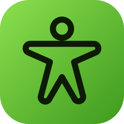

<p align="center">
  
</p>

<h1 align="center">GEM-X Studio</h1>

<p align="center">
  <em>Turn videos into 3D body, hand and motion capture on your own PC, then refine it and export it to Blender, game engines or MikuMikuDance.</em><br>
  A one-click Windows installer and desktop app for <a href="https://github.com/NVlabs/GEM-X">NVIDIA GEM-X</a>.
</p>

<p align="center">
  <a href="#studio-install"></a>
  <a href="#studio-exports"></a>
  <a href="https://github.com/NVlabs/GEM-X"></a>
  <a href="#license"></a>
</p>

<p align="center">
  <a href="#studio-install">Install</a> ·
  <a href="#studio-features">Features</a> ·
  <a href="#studio-exports">Exports</a> ·
  <a href="#studio-tips">Tips</a> ·
  <a href="docs/STUDIO.md">Full Studio guide</a> ·
  <a href="#original-readme">Original GEM-X README</a>
</p>

---

<a id="studio-install"></a>

## Install (Windows)

1. Download or clone this repository.
2. Double-click **`install.bat`**. It sets everything up inside the repository folder:
   a private Python 3.12, PyTorch 2.10 for your NVIDIA driver, GEM-X, GPU detectors,
   FFmpeg and the app itself. Nothing is installed system-wide, and you do not need
   Python, Node.js or FFmpeg beforehand.
3. Pick which models to download when asked, or skip and use the **Models** page later.
4. Start **GEM-X Studio** from the Desktop or Start Menu shortcut (or `studio.bat`).

Want nothing at all outside the folder? Answer **yes** to *Portable install* (or run
`install.bat -Portable`). Download caches (uv, npm, Hugging Face) then live in `.tools`
and are emptied when the installer finishes. The caches Studio writes while it runs,
and its window profile, stay in `.tools` too. Only the shortcuts are created elsewhere;
add `-NoShortcut` to skip them.

**You need:** 64-bit Windows 10 or 11, an internet connection and, for usable speed, an
NVIDIA GPU with a recent driver (CUDA 12.6 or newer) and about 7 GB of free VRAM for Body
Motion. **Disk:** about 8 GB for Body Pose, 12 GB with Body Motion and 24 GB with every
model, including the 4 GB Python environment. Re-running `install.bat` is safe and also
serves as an updater after `git pull`.

<a id="studio-features"></a>

## Features

- **Three GEM-X models in one app:** Body Pose (images and video), Hand Pose (left and
  right hands, images and video) and Body Motion (temporal, world-space motion from
  video, up to 60 seconds per run).
- **Drop in your media** and runs are queued on the GPU one at a time, each in its own
  process, with live progress and logs. Everything is kept for later.
- **Interactive viewer:**
  - *Overlay*: the mesh drawn exactly over the video, with optional 2D keypoints.
  - *3D*: look through the original camera, then orbit; the camera's tilt and
    height are shown.
  - *World*: gravity-aligned motion on a floor, with its trajectory.
- **Refine without re-running:**
  - Temporal smoothing for Pose videos.
  - For Body Motion:
    - Anchor the motion to a fixed camera, so there is no drift.
    - Auto-level the world on the floor (fixes cameras tilted up or down).
    - Plant the feet flat on the ground.
    - Adjust the floor height and lean by hand.
- **Models page** with one-click downloads, and a native app window (Edge WebView2),
  or run it in your browser with `studio.bat --browser`.

<a id="studio-exports"></a>

## Exports

| Export | For |
| --- | --- |
| Skinned skeleton **glTF** (written natively) and **FBX** (via a local Blender) | Blender, Unity, Unreal, Maya, three.js; bone names *Standard* or *MMD* |
| **VMD** motion | MikuMikuDance and other MMD tools, retargeted to standard MMD bones including fingers |
| Shape-key glTF / FBX, point cache (PC2), OBJ sequence, NumPy | The exact per-frame mesh |
| MP4 render, PNG screenshot | Exactly what the viewer shows |
| `predictions.pt` / JSON | The full GEM-X result, as produced by `gem-infer` |

<a id="studio-tips"></a>

## Tips

- **Body Motion:** answer *"Is the camera moving?"* honestly. For a tripod or phone on a
  stand, keep **No, fixed**: Studio then anchors the motion in place and levels it on the
  floor automatically.
- **Character animation:** use Body Motion, which is smooth, moves through the world and
  has foot contact. Pose is best for single images, hands and clips longer than 60 seconds.
- **MMD:** set *Model arm angle* to your model's rest pose (most MMD models are 30–40°,
  T-pose models 0°).
- **FBX** needs [Blender](https://www.blender.org/download/) (free). Studio finds it
  automatically, or set its path in Settings.

Everything else, including options, folders and development setup, is in the
**[GEM-X Studio guide](docs/STUDIO.md)**.

## Credits

GEM-X, its models and weights are by NVIDIA; see the original README below and the
[license](#license). GEM-X Studio adds the installer and app on top, leaving the model code
unchanged. This fork has mostly been developed and maintained with AI assistance; see
[About this fork](#about-this-fork).

---

<a id="original-readme"></a>

> **The original GEM-X README follows**, unchanged except for small additions that
> point to Studio.


<h1 align="center">GEM-X: Full-Body and Hand Pose Estimation from Image and Video</h1>

<p align="center">
  <em>Unified body pose, hand pose, and temporal motion estimation with SOMA</em>
</p>

<p align="center">
  <a href="https://research.nvidia.com/labs/dair/gem/"></a>
  <a href="#license"></a>
  <a href="https://www.python.org/"></a>
  <a href="https://pytorch.org/"></a>
  <a href="https://developer.nvidia.com/cuda/toolkit"></a>
</p>

<p align="center">
  <a href="#news">News</a> ·
  <a href="#quick-start">Quick Start</a> ·
  <a href="#pretrained-models">Pretrained Models</a> ·
  <a href="#evaluation">Evaluation</a> ·
  <a href="#training--evaluation">Training &amp; Evaluation</a> ·
  <a href="#documentation">Documentation</a>
</p>

---

<p align="center">
  <a href="assets/gemx_overview.mp4">
    
  </a>
  <br>
  <b>Full-body pose and motion from images and video.</b>
</p>

<a id="hand-showcase"></a>
<p align="center">
  <a href="assets/hand_pose.mp4">
    
  </a>
  <br>
  <b>Detailed hand pose from images and video.</b>
</p>

<a id="news"></a>

## 📰 News

- **[2026-10-21]** 🚀 GEM-X supports **Hand Pose** alongside **Body Pose** and temporal **Body Motion**, with image/video inference, shared training workflows, and fine-tuning from pretrained Pose checkpoints. Get started with the [Quick Start](#quick-start) and [pretrained models](#pretrained-models).
- **[2025-06]** Added ONNX/TensorRT acceleration to the original GEM demo.
- **[2025-06]** Added motion retargeting to Unitree G1 with [SOMA Retargeter](https://github.com/NVIDIA/soma-retargeter).
- **[2025-05]** Released the original **GEM** codebase.

<a id="overview"></a>

## 🔎 Overview

GEM-X provides **Body Pose**, **Hand Pose**, and **Body Motion** in a shared
framework for inference, training, and evaluation. Body and Hand Pose reconstruct
3D geometry from individual images. Body Motion uses temporal context to estimate
camera-space and world-space human motion from monocular video. All three models
use [SOMA](https://github.com/NVlabs/SOMA-X) geometry.

<a id="key-features"></a>

## ✨ Key Features

- **Full-body and hand reconstruction** — dedicated image models for body pose
  and detailed left and right hand geometry.
- **Temporal body motion** — person tracking, 2D keypoint observations, and Body
  Pose features feed a temporal model that predicts camera-space and world-space motion.
- **Flexible hand inputs** — supplied boxes or RT-DETR detection, ego/exo
  processing profiles, optional tracking and smoothing, and calibrated camera adapters.
- **Robotics showcase** — recovered SOMA motion retargeted to Unitree G1 with [SOMA Retargeter](https://github.com/NVIDIA/soma-retargeter); see the [application demo](assets/g1_retarget.mp4).
- **Training and fine-tuning** — train Body Pose, Hand Pose, and Body Motion;
  fine-tune pretrained weights or resume a complete training checkpoint.
- **Visualization and evaluation** — render saved predictions, apply optional
  contact/IK correction, and evaluate with native Hand metrics or custom evaluators.

<a id="models-and-inference-modes"></a>

## 🧩 Models and Inference Modes

There are **three models and four inference modes**. The command identifies the
model family and input type; `--task` selects body or hand.

| Command | Task | Prediction |
| --- | --- | --- |
| `pose-image` | `body`, `hand` | Body or Hand Pose from one image |
| `pose-video` | `body`, `hand` | Body or Hand Pose independently on each video frame |
| `motion-video` | `body` | Temporal Body Motion with automatic video preprocessing |
| `motion-cache` | `body` | Temporal Body Motion from cached features and observations |

`pose-video` runs the image model frame by frame. Hand tracking and smoothing are
optional processing stages; learned temporal prediction is provided by Body Motion.
See [Model Overview](docs/MODEL_OVERVIEW.md) for architecture and output conventions.

<a id="quick-start"></a>

## 🚀 Quick Start

> **On Windows?** Double-click **`install.bat`** to set up everything (Python,
> CUDA PyTorch, GEM-X, models) and launch **GEM-X Studio**, a desktop app to run
> Body Pose, Hand Pose and Body Motion on your own images and videos, preview the
> results in 3D, and export meshes or rendered video. See [GEM-X Studio](docs/STUDIO.md).

### 1. Install

Use Python 3.10 or newer and install a PyTorch 2.10 build for your device. From
this checkout:

```bash
python -m venv .venv
source .venv/bin/activate
python -m pip install --upgrade pip
# Install the PyTorch build for your CPU or CUDA environment before this step.
python -m pip install -e '.[video,hand]'
```

Install FFmpeg for video processing. For the rendering commands below, install
`python -m pip install -e '.[render]'` and the
[rendering dependencies](docs/INSTALL.md#rendering-dependencies) in a Linux x86-64
environment. See [Installation](docs/INSTALL.md) for CPU/CUDA setup, Docker,
ARM64 inference, and optional dependencies.

### 2. Prepare weights and assets

GEM installs the SOMA 0.3.3 Python runtime. Download the model and geometry files
separately, following the instructions for your task:

1. Download the [model checkpoints](docs/PRETRAINED_MODELS.md#download-checkpoints)
   into `weights/`.
2. For automatic Body Pose or Body Motion, download and extract the
   [YOLOX person detector](docs/PRETRAINED_MODELS.md#person-detector-for-body-motion)
   to `weights/yolox_humanart.onnx`.
3. Download the [SOMA v0.3.3 assets](docs/INSTALL.md#soma-code-and-assets)
   into `assets/soma/`. The examples below use that directory.

### 3. Run inference

**Body Pose — image**

Detect the main person automatically using `weights/yolox_humanart.onnx`:

```bash
gem-infer pose-image --task body --input image.jpg \
  --release body --checkpoint weights/body_s240000.ckpt \
  --soma-assets assets/soma --device cuda --output body.pt
gem-render --task body --input body.pt --output-dir outputs/body
```

Use `--body-detector PATH` for another detector location. For calibrated cameras
or multiple people, see [camera settings and supplied boxes](docs/DEMO.md#body-image).
The same automatic setup supports [framewise Body Pose video](docs/DEMO.md#body-framewise-video).

**Hand Pose — video**

Use the [EgoHand checkpoint](https://huggingface.co/nvidia/EgoHand-v1) and a local
[RT-DETR Hand Detector](https://huggingface.co/nvidia/RT-DETR-Hand-Detector-v1):

```bash
gem-infer pose-video --task hand --input video.mp4 \
  --release hand --checkpoint weights/egohand_s060000.ckpt \
  --hand-detector weights/hand_detector.onnx \
  --soma-assets assets/soma --device cuda --output hands.pt
gem-render --task hand --input hands.pt --output-dir outputs/hand
```

The default `--hand-view exo` processes detections independently per frame.
For the camera wearer's hands, add `--hand-view ego` to enable video tracking,
crop stabilization, and parameter smoothing. Supplied boxes and calibrated
pinhole/fisheye inputs are covered in the [Hand inference guide](docs/DEMO.md#hand-image-or-framewise-video).

**Body Motion — video**

Configure the local model paths and 2D keypoint detector identifier in
[`body_video_native77.yaml`](docs/configs/body_video_native77.yaml), then run:

```bash
gem-infer motion-video --task body --input video.mp4 \
  --config docs/configs/body_video_native77.yaml --device cuda \
  --postprocess --soma-assets assets/soma --output motion.pt
gem-render --task body --input motion.pt --soma-assets assets/soma \
  --device cuda --output-dir outputs/motion
```

Body Motion produces camera and world views. This example uses `--postprocess`
for the Contact/IK correction shown in the films; omit it for raw predictions.
For a moving camera, add `--camera-mode vipe` and follow the
[optional ViPE setup](docs/VIPE_CAMERA.md). For a fixed camera, use
`--camera-mode static`.
The [Inference guide](docs/DEMO.md) explains input formats, output fields, cached
prediction, camera handling, and postprocessing.

<a id="pretrained-models"></a>

## 📦 Pretrained Models

Download the weights for your task from the following Hugging Face repositories:

| Model | Checkpoint | Configuration | Weight source |
| --- | --- | --- | --- |
| Body Pose | `body_s240000.ckpt` | `body` | [nvidia/GEM-X](https://huggingface.co/nvidia/GEM-X/tree/main) |
| Hand Pose | `egohand_s060000.ckpt` | `hand` | [nvidia/EgoHand-v1](https://huggingface.co/nvidia/EgoHand-v1) |
| Body Motion | Native77 final775 | [Native77 configuration](docs/configs/body_video_native77.yaml) | [nvidia/GEM-X](https://huggingface.co/nvidia/GEM-X/tree/main) |

Hand weights are distributed by the official EgoHand repository; access is
managed there. See the [download commands](docs/PRETRAINED_MODELS.md#download-checkpoints).

Body Motion uses Body Pose image features and **77-point 2D keypoint observations**.
Native29 is an alternate layout for separately trained weights.

See [Pretrained Models](docs/PRETRAINED_MODELS.md) for checkpoint availability,
asset requirements, matching detector identifiers, and compatibility details.

<a id="evaluation"></a>

## 📊 Evaluation

### GEM-pose · Body Pose

Single-frame results for the released `body_s240000.ckpt`. Errors are in
millimeters; lower is better.

| Dataset | MPJPE ↓ | PA-MPJPE ↓ | PVE ↓ |
| --- | ---: | ---: | ---: |
| 3DPW | 62.20 | 39.56 | 72.89 |
| EMDB-1 | 67.83 | 43.14 | 80.27 |

The [Body Pose benchmark guide](docs/BODY_BENCHMARKS.md) covers official dataset
downloads, local preparation and fixed 3DPW/EMDB-1 joint evaluation configurations.
The joint runner does not compute PVE.

### GEM-motion · Body Motion

EMDB-2 results use **original ViTPose**, the released **native77 final775**
checkpoint and **Contact/IK postprocessing enabled**. The benchmark uses
provided camera intrinsics and camera rotations. Lower is better.

| W-MPJPE₁₀₀ | WA-MPJPE₁₀₀ | RTE (%) | Jitter | Foot sliding |
| ---: | ---: | ---: | ---: | ---: |
| 267.20 | 112.76 | 2.45 | 34.21 | 4.22 |

W-MPJPE₁₀₀, WA-MPJPE₁₀₀ and foot sliding are in millimeters.
Jitter uses the reference reporting scale: mean jerk at 30 Hz divided by 10.
See [evaluation settings and metric definitions](docs/EVAL.md#release-benchmark-results)
for coverage, alignment and aggregation details.
The [Motion benchmark guide](docs/MOTION_BENCHMARKS.md) covers raw-data preparation,
feature extraction and standalone raw/Contact-IK evaluation. It documents
differences from historical input caches.
Both tasks use the [shared projector bundle](https://huggingface.co/nvidia/GEM-X/tree/main/evaluation/projectors_v1):
`emdb_projector.pt` and `3dpw_projector.pt`.

<a id="training--evaluation"></a>

## 🏋️ Training & Evaluation

Install the training and evaluation dependencies:

```bash
python -m pip install -e '.[train,eval]'
```

| Model | Training command | Guide |
| --- | --- | --- |
| Body Pose | `gem-train pose --task body --config training.yaml` | [Body Pose training](docs/POSE_TRAINING.md) |
| Hand Pose | `gem-train pose --task hand --config training.yaml` | [Hand Pose training](docs/HAND_TRAINING.md) |
| Body Motion | `gem-train motion --config training.yaml` | [Motion training](docs/TRAINING.md#body-motion) |

Start with the [Training & Evaluation guide](docs/TRAINING.md) for data preparation
contracts, example configurations, initialization, and full checkpoint recovery.
To fine-tune Hand Pose from `egohand_s060000.ckpt`, use the
[Hand fine-tuning recipe](docs/HAND_TRAINING.md#egohand-fine-tuning).

`gem-eval pose` evaluates Body or Hand Pose; `gem-eval motion` evaluates complete
EMDB/3DPW Motion sequences. Body Pose includes 3DPW/EMDB-1 joint protocols;
Hand includes native SOMA25 metrics. Custom Body and Motion evaluators remain
supported. See [Evaluation](docs/EVAL.md)
for configuration and metric definitions.

<a id="documentation"></a>

## 📚 Documentation

| Guide | Contents |
| --- | --- |
| [Installation](docs/INSTALL.md) | Environment setup, SOMA assets, rendering, and Docker |
| [GEM-X Studio](docs/STUDIO.md) | One-click Windows installer and desktop app for inference, 3D preview, and export |
| [Pretrained Models](docs/PRETRAINED_MODELS.md) | Checkpoints, detector pairing, and local weight setup |
| [Inference](docs/DEMO.md) | Image, video, and cached inference; camera adapters and visualization |
| [ViPE Cameras](docs/VIPE_CAMERA.md) | Optional automatic camera estimation for Body Motion |
| [Training & Evaluation](docs/TRAINING.md) | Training entry points, prepared examples, validation, and resume |
| [Body Pose Training](docs/POSE_TRAINING.md) | Body sample format, objectives, and initialization |
| [Hand Pose Training](docs/HAND_TRAINING.md) | Hand fine-tuning, canonical inputs, and objectives |
| [Evaluation](docs/EVAL.md) | Release benchmark results, metric definitions, and custom evaluators |
| [Body Pose Benchmarks](docs/BODY_BENCHMARKS.md) | Official downloads, raw-data preparation, and 3DPW/EMDB-1 joint evaluation |
| [Motion Benchmarks](docs/MOTION_BENCHMARKS.md) | Sequence preparation, feature extraction, raw/Contact-IK evaluation, and optional mesh metrics |
| [Model Overview](docs/MODEL_OVERVIEW.md) | Model architectures, conditioning, and outputs |
| [Architecture](docs/ARCHITECTURE.md) | Package structure and component responsibilities |

For development setup and contribution guidelines, see [Contributing](CONTRIBUTING.md).

<a id="production-deployment-with-nvidia-ai-for-media"></a>

## 🏭 Production Deployment with NVIDIA AI for Media

For developers looking to integrate 3D body pose estimation into real-world
applications, NVIDIA provides production-ready deployment options through the
[NVIDIA AI for Media](https://developer.nvidia.com/topics/ai/generative-ai/ai-for-media)
SDK and NIM.

- **[NVIDIA 3D Body Pose Estimation – AR SDK](https://catalog.ngc.nvidia.com/orgs/nvidia/maxine/collections/nvar3dbodyposeestimation/-):**
  GPU-accelerated SDK supporting live video processing, enabling continuous 3D
  human body pose and motion estimation.
- **[NVIDIA 3D Body Pose NIM](https://catalog.ngc.nvidia.com/orgs/nim/nvidia/containers/body-pose/-):**
  Containerized inference microservice for integrating 3D body pose estimation
  into scalable video processing workflows.

Explore the full
[NVIDIA Augmented Reality SDK](https://catalog.ngc.nvidia.com/orgs/nvidia/maxine/collections/maxine_ar_sdk/-)
for additional AI-powered video capabilities.

<a id="license"></a>

## 📄 License

The default source license is [Apache 2.0](LICENSE). Adapted Hand processing
files and the source-camera restoration function retain their
`LicenseRef-OpenMDW-1.1` notices. See [ATTRIBUTIONS.md](ATTRIBUTIONS.md) for the
complete mapping of file and function exceptions, and
[OpenMDW-1.1](LICENSES/LicenseRef-OpenMDW-1.1.txt) for their license.

Model weights, geometry assets, and dependencies retain their respective terms;
see their distributions and the component notices in [ATTRIBUTIONS.md](ATTRIBUTIONS.md).
Media sources and credits are listed in [assets/CREDITS.md](assets/CREDITS.md).

<a id="about-this-fork"></a>

## 🤖 About this fork

**GEM-X Studio** is a community fork of [NVlabs/GEM-X](https://github.com/NVlabs/GEM-X)
that adds a one-click Windows installer and a desktop app for running, previewing,
refining and exporting GEM-X results; see [GEM-X Studio](docs/STUDIO.md). The model
code and weights are unchanged and remain NVIDIA's work under the terms above.

This fork has mostly been developed and maintained with AI assistance (Claude), with
human direction and testing.
